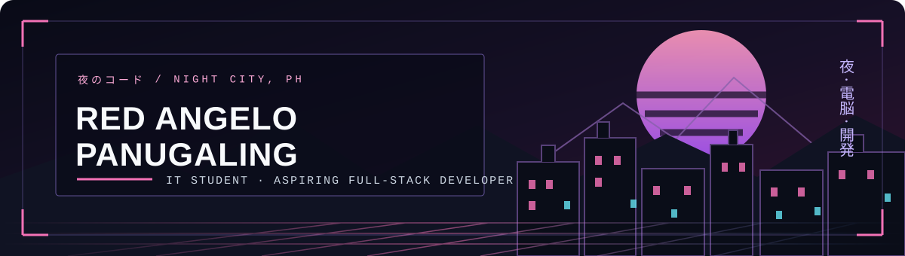
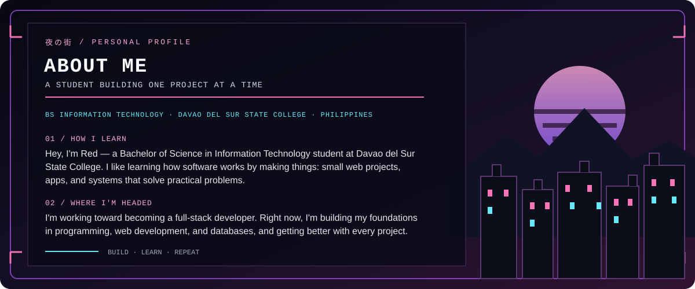
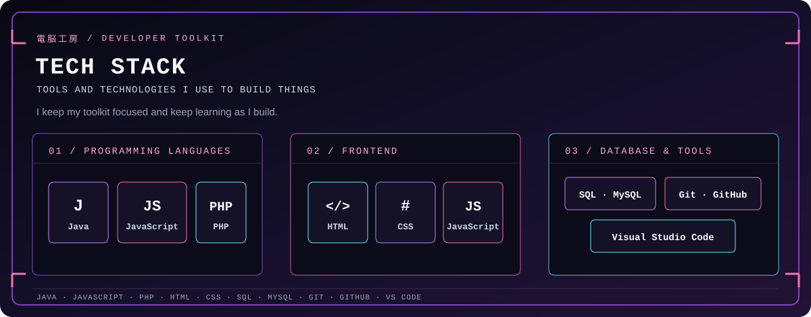
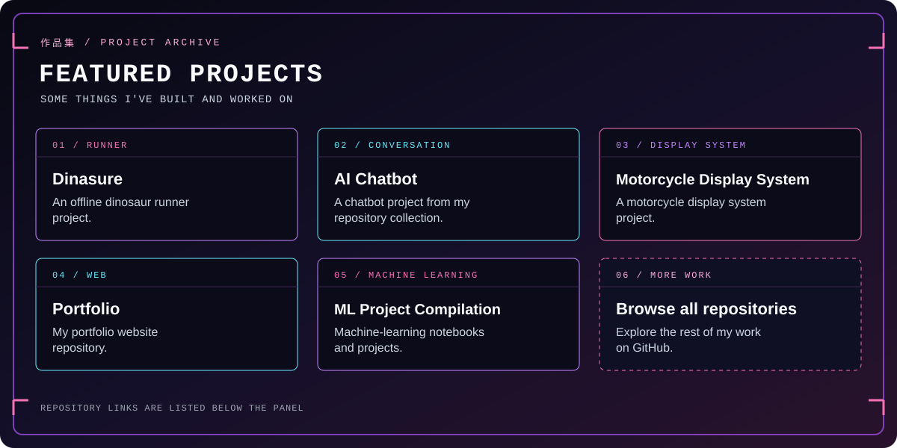
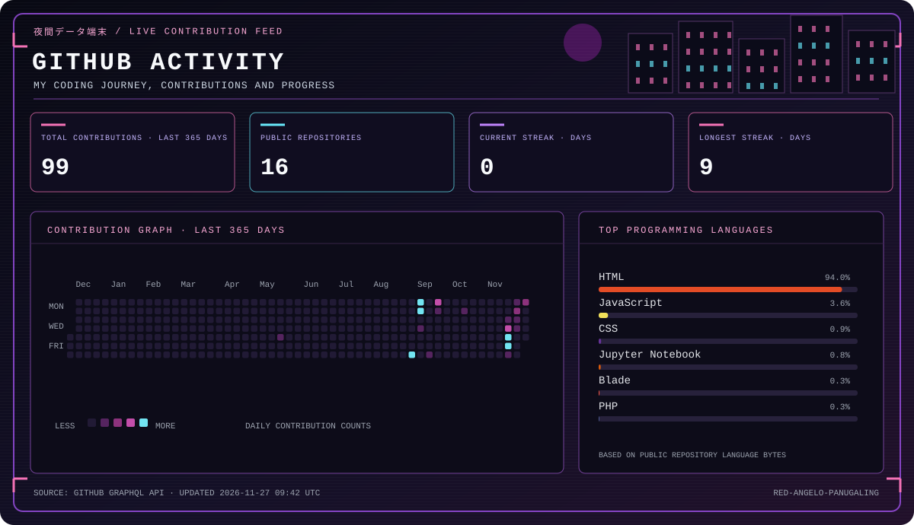
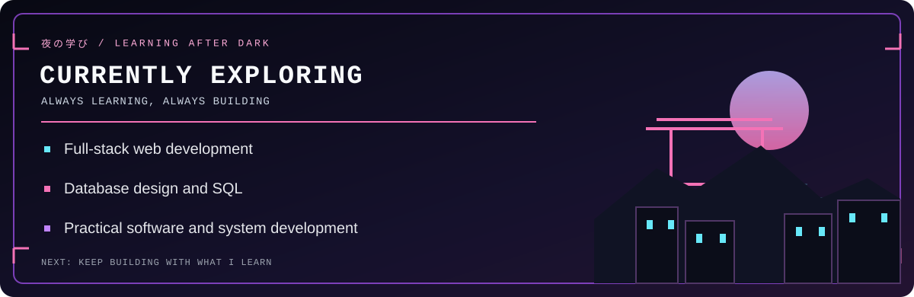

**Red Angelo Panugaling** &nbsp;·&nbsp; Davao del Sur State College &nbsp;·&nbsp; Philippines

[About](#about-me) &nbsp;·&nbsp; [Tech Stack](#tech-stack) &nbsp;·&nbsp; [Projects](#featured-projects) &nbsp;·&nbsp; [Activity](#github-activity) &nbsp;·&nbsp; [Exploring](#currently-exploring) &nbsp;·&nbsp; [Connect](#connect)

---

<h2 id="about-me"></h2>

<h2 id="tech-stack"></h2>

<h2 id="featured-projects"></h2>

[Dinasure](https://github.com/red-angelo-panugaling/dinasure) &nbsp;·&nbsp; [AI Chatbot](https://github.com/red-angelo-panugaling/aichatbot) &nbsp;·&nbsp; [Motorcycle Display System](https://github.com/red-angelo-panugaling/motorcycle_display_system) 
[Portfolio](https://github.com/red-angelo-panugaling/portfolio) &nbsp;·&nbsp; [ML Project Compilation](https://github.com/red-angelo-panugaling/ml-project-compiltion) &nbsp;·&nbsp; [Browse all repositories](https://github.com/red-angelo-panugaling?tab=repositories)

<h2 id="github-activity"></h2>

<a href="https://github.com/red-angelo-panugaling">View GitHub profile</a> &nbsp;·&nbsp; <a href="https://github.com/red-angelo-panugaling?tab=repositories">Browse repositories</a>

<h2 id="currently-exploring"></h2>

<h2 id="connect"></h2>

---

*Keep learning. Keep building. See you in the next project.*

