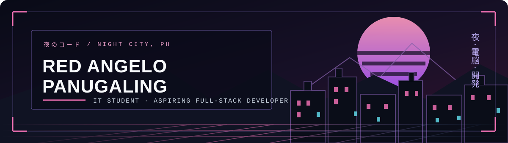
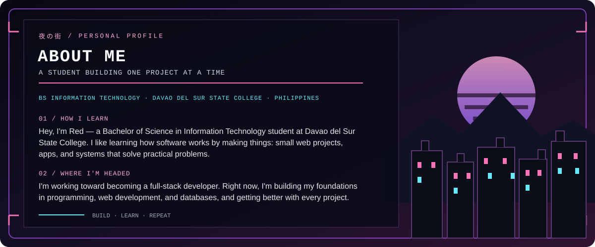
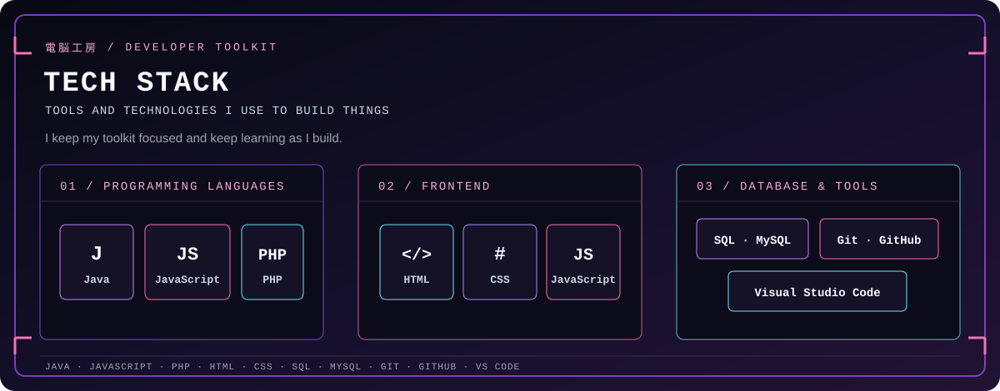
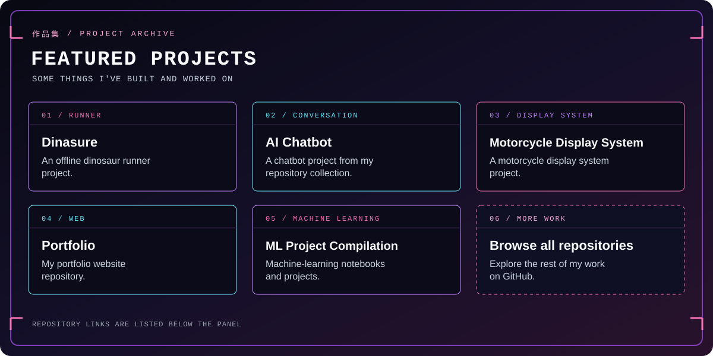
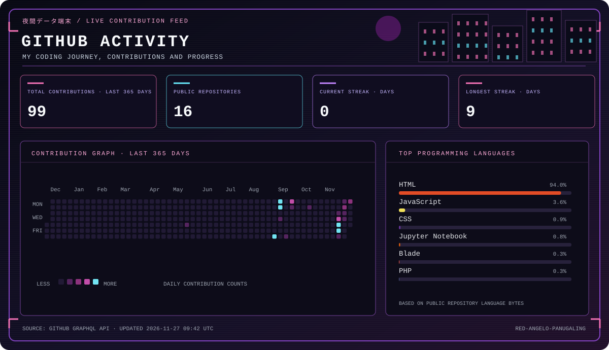
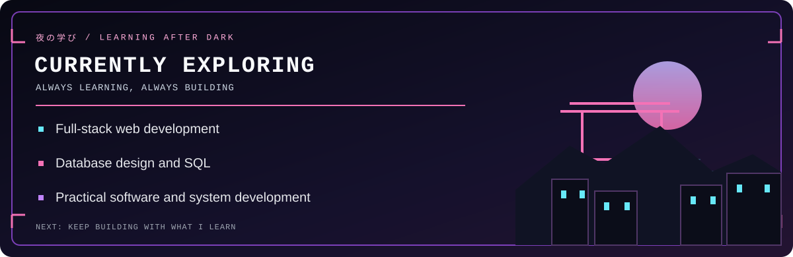

**Red Angelo Panugaling** &nbsp;·&nbsp; Davao del Sur State College &nbsp;·&nbsp; Philippines

[About](#about-me) &nbsp;·&nbsp; [Tech Stack](#tech-stack) &nbsp;·&nbsp; [Projects](#featured-projects) &nbsp;·&nbsp; [Activity](#github-activity) &nbsp;·&nbsp; [Exploring](#currently-exploring) &nbsp;·&nbsp; [Connect](#connect)

---

<h2 id="about-me"></h2>

Hey, I'm Red - a **Bachelor of Science in Information Technology** student at **Davao del Sur State College**. I like learning how software works by making things: small web projects, apps, and systems that solve practical problems.

I'm working toward becoming a full-stack developer. Right now, I'm building my foundations in programming, web development, and databases, and getting better with every project.

<h2 id="tech-stack"></h2>

I keep my toolkit focused and keep learning as I build.

<strong>Programming languages</strong> 

<strong>Frontend</strong> 

<strong>Database and tools</strong> 

`SQL` &nbsp; `MySQL`

 

<h2 id="featured-projects"></h2>

| &nbsp; | &nbsp; |
|:---|:---|
| **🦖 [Dinasure](https://github.com/red-angelo-panugaling/dinasure)** An offline dinosaur runner project. | **🤖 [AI Chatbot](https://github.com/red-angelo-panugaling/aichatbot)** A chatbot project from my repository collection. |
| **🏍️ [Motorcycle Display System](https://github.com/red-angelo-panugaling/motorcycle_display_system)** A motorcycle display system project. | **🧩 [Portfolio](https://github.com/red-angelo-panugaling/portfolio)** My portfolio website repository. |
| **📓 [ML Project Compilation](https://github.com/red-angelo-panugaling/ml-project-compiltion)** Machine-learning notebooks and projects. | **[Browse all repositories →](https://github.com/red-angelo-panugaling?tab=repositories)** Explore the rest of my work on GitHub. |

<h2 id="github-activity"></h2>

<a href="https://github.com/red-angelo-panugaling">View GitHub profile</a> &nbsp;·&nbsp; <a href="https://github.com/red-angelo-panugaling?tab=repositories">Browse repositories</a>

<h2 id="currently-exploring"></h2>

- Full-stack web development
- Database design and SQL
- Practical software and system development

<h2 id="connect"></h2>

---

*Keep learning. Keep building. See you in the next project.*

